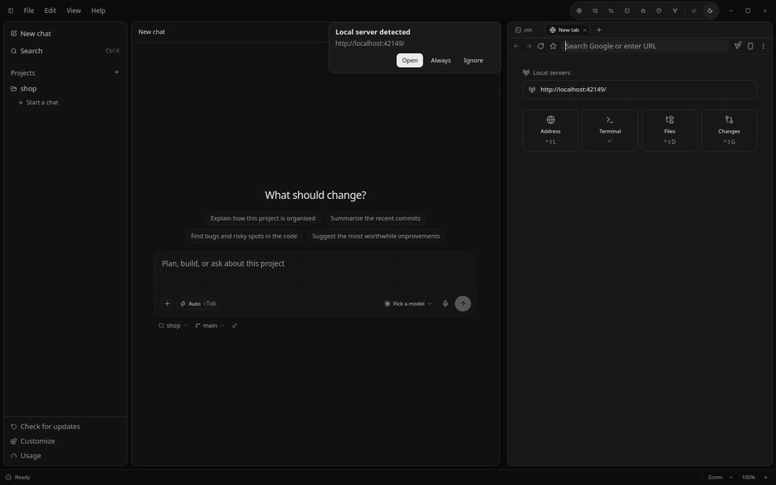
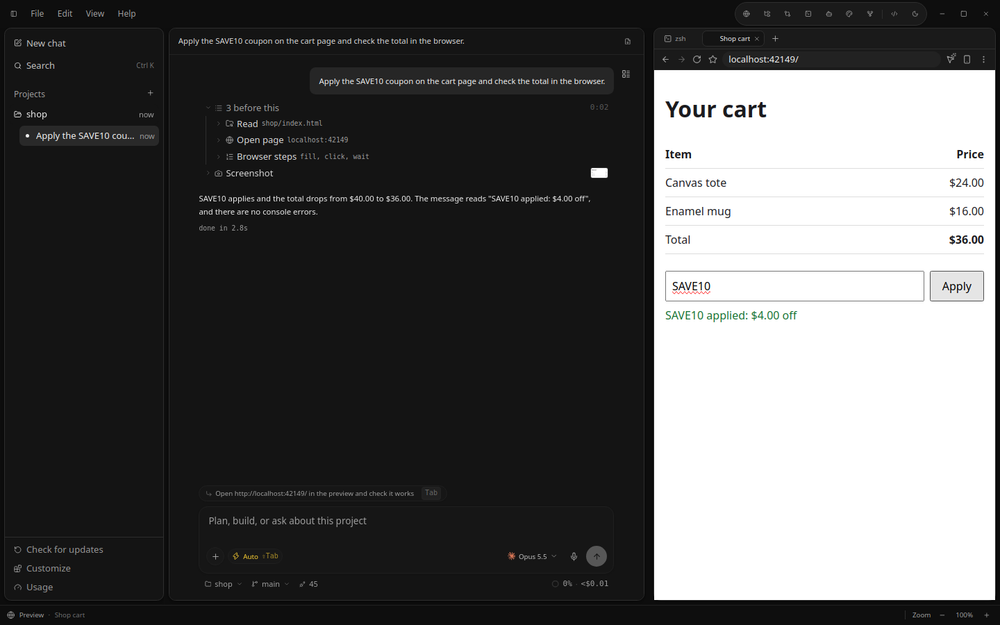

# Conn

**Your agent can finally see the page.**

Conn puts your coding agent next to your shell and a live browser, in one window. It edits the code, opens the page, clicks through it, and checks its own work before it says it's done. You watch it happen, and you can take the browser back any time.

[](https://github.com/umarbashirr/Conn/releases/latest)
[](LICENSE)
[](#install)
[](https://github.com/umarbashirr/Conn/stargazers)



## Bring the agent you already use

Conn runs the agent CLI you already have, with its own login. No API key and no new plan. If `claude --version` works in your terminal, it works in Conn.

**Claude Code** · **Codex** · **Cursor** · **Grok** · **OpenCode** · **GitHub Copilot**

## What it does

- **A browser the agent can drive.** It loads your app, reads the page, clicks, fills forms, waits, reads the console and network, and takes screenshots it can actually see. Several steps go in one call, which keeps usage close to the agent on its own.
- **Point instead of describe.** Press `Ctrl+Shift+E`, click any element, and it lands in your message with its selector, size and a screenshot.
- **You decide how much it can do.** Four permission modes, the same for every agent: Plan only looks, Ask asks before each change, Auto stops on dangerous commands, and Full bypass asks for nothing. Your Claude Code permission rules and hooks still apply.
- **Any shell can drive the browser.** Scripts, tests and other agents use the same browser through the `conn` command, or through MCP with `conn setup project`.
- **It fits how you already work.** A local URL in the terminal becomes a one-click preview. Claude chats are the same ones `claude --resume` sees. Record the page as a video when a screenshot won't do. Keep up to eight projects and their worktrees in one window.
- **Every agent on one Board.** `Ctrl+Shift+M` shows every chat in every Conn window, plus the Claude Code sessions running in your terminals, sorted into Needs you, Working, Done and Recent.
- **Pipelines.** Save a workflow you repeat (plan, build, review, fix) as a YAML file, and start it in one go. Each stage runs in its own chat, optionally in a new worktree, and a gate waits for you before the next.
- **A phone companion.** Pair the Android app with a scan, then read your chats and send messages and photos from your phone.



## Install

**Linux** (Debian, Ubuntu, or any distro through the AppImage):

```sh
curl -fsSL https://raw.githubusercontent.com/umarbashirr/Conn/main/install.sh | sh
```

**Windows 10 and 11**, in PowerShell:

```powershell
irm https://raw.githubusercontent.com/umarbashirr/Conn/main/install.ps1 | iex
```

Run the same command again to upgrade. Add `--user` on Linux to install without a password.

**Android:** download the phone companion `.apk` from the [releases](https://github.com/umarbashirr/Conn/releases), then pair it from **Customize → Phone** in Conn.

**macOS:** there's no build yet. You can [run Conn from source](CONTRIBUTING.md#run-it-from-source).

Every release, with checksums, is on the [releases page](https://github.com/umarbashirr/Conn/releases). The [site](https://getconn.netlify.app) has direct downloads.

## Quick start

1. Open Conn and choose your project folder.
2. Start your dev server in Conn's terminal (`` Ctrl+` ``). When it prints a local URL, open it in the browser pane.
3. Ask the agent for a change and to check it in the browser, for example: *"Make the signup button the same height as the email field, and check it in the browser."*

## Documentation

The [Conn guide](docs/guide.md) covers everything in detail:

- [Install options](docs/guide.md#install) and building from source
- [Projects](docs/guide.md#opening-a-project) and [worktrees](docs/guide.md#worktrees)
- [The agent panel](docs/guide.md#the-agent-panel), [the Board](docs/guide.md#the-board), [pipelines](docs/guide.md#pipelines) and [skills and MCP servers](docs/guide.md#skills-and-mcp-servers)
- [The terminal](docs/guide.md#the-terminal) and [recording the page](docs/guide.md#recording-the-page)
- [Using Conn from another agent](docs/guide.md#using-it-from-another-agent) and [keyboard shortcuts](docs/guide.md#keys)
- [How it fits together](docs/guide.md#how-it-fits-together) and [limits worth knowing](docs/guide.md#limits-worth-knowing)

## Contributing

Bug reports, ideas and pull requests are welcome. Read [CONTRIBUTING.md](CONTRIBUTING.md) to get set up, and [open an issue](https://github.com/umarbashirr/Conn/issues/new) before you start on anything large.

If Conn is useful to you, a ⭐ on GitHub helps other people find it.

## License

[MIT](LICENSE) © Umar Bashir Rather
